                ### Домашнее задание к занятию 11 «Teamcity» - Нугаев Алексей

## Подготовка к выполнению

1. В Yandex Cloud создайте новый инстанс (4CPU4RAM) на основе образа `jetbrains/teamcity-server`.
2. Дождитесь запуска teamcity, выполните первоначальную настройку.
3. Создайте ещё один инстанс (2CPU4RAM) на основе образа `jetbrains/teamcity-agent`. Пропишите к нему переменную окружения `SERVER_URL: "http://<teamcity_url>:8111"`.
4. Авторизуйте агент.
5. Сделайте fork [репозитория](https://github.com/aragastmatb/example-teamcity).
6. Создайте VM (2CPU4RAM) и запустите [playbook](./infrastructure).

## Основная часть

1. Создайте новый проект в teamcity на основе fork.
2. Сделайте autodetect конфигурации.
3. Сохраните необходимые шаги, запустите первую сборку master.
4. Поменяйте условия сборки: если сборка по ветке `master`, то должен происходит `mvn clean deploy`, иначе `mvn clean test`.
5. Для deploy будет необходимо загрузить [settings.xml](./teamcity/settings.xml) в набор конфигураций maven у teamcity, предварительно записав туда креды для подключения к nexus.
6. В pom.xml необходимо поменять ссылки на репозиторий и nexus.
7. Запустите сборку по master, убедитесь, что всё прошло успешно и артефакт появился в nexus.
8. Мигрируйте `build configuration` в репозиторий.
9. Создайте отдельную ветку `feature/add_reply` в репозитории.
10. Напишите новый метод для класса Welcomer: метод должен возвращать произвольную реплику, содержащую слово `hunter`.
11. Дополните тест для нового метода на поиск слова `hunter` в новой реплике.
12. Сделайте push всех изменений в новую ветку репозитория.
13. Убедитесь, что сборка самостоятельно запустилась, тесты прошли успешно.
14. Внесите изменения из произвольной ветки `feature/add_reply` в `master` через `Merge`.
15. Убедитесь, что нет собранного артефакта в сборке по ветке `master`.
16. Настройте конфигурацию так, чтобы она собирала `.jar` в артефакты сборки.
17. Проведите повторную сборку мастера, убедитесь, что сбора прошла успешно и артефакты собраны.
18. Проверьте, что конфигурация в репозитории содержит все настройки конфигурации из teamcity.
19. В ответе пришлите ссылку на репозиторий.

---

### Как оформить решение задания

Выполненное домашнее задание пришлите в виде ссылки на .md-файл в вашем репозитории.

---

# Решение

1. Привязал GitHub-репозиторий, включил автоопределение, создали триггер и успешно провел первый ручной запуск сборки.
2. Создал в терминале ветку Решение, запушил её на GitHub, и TeamCity автоматически поймал её и протестировал. 
3. Сгенерировали токен на GitHub и перевел проект в режим синхронизации настроек. TeamCity сам отправил файлы конфигурации в мой репозиторий.
4. Переключился на ветку feature/add_reply, добавил новый метод в Java-код и написал для него юнит-тест. Робот автоматически собрал эту ветку, и количество успешных тестов выросло с 5 до 6 
5. сделали git merge feature/add_reply обратно в ветку master и отправили код на GitHub. TeamCity запустил сборку #5 со всеми 6 тестами, убедился, что файлы артефактов пока не собираются.
6. Открыл файл конфигурации проекта .teamcity/settings.kts в терминале, прописал туда строчку artifactRules = "target/*.jar" и сделали пуш. TeamCity подхватил новые настройки из кода и выполнил сборку #6, у которой с правого края успешно загорелся значок коробки с готовым .jar файлом.

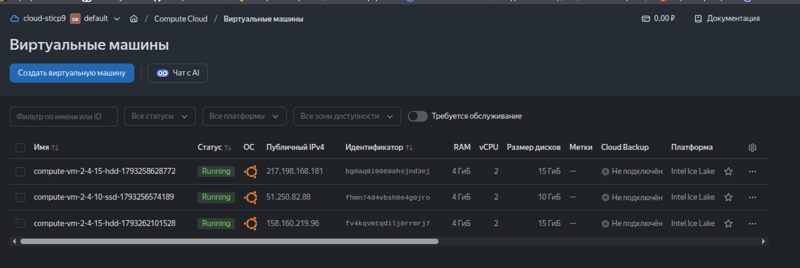
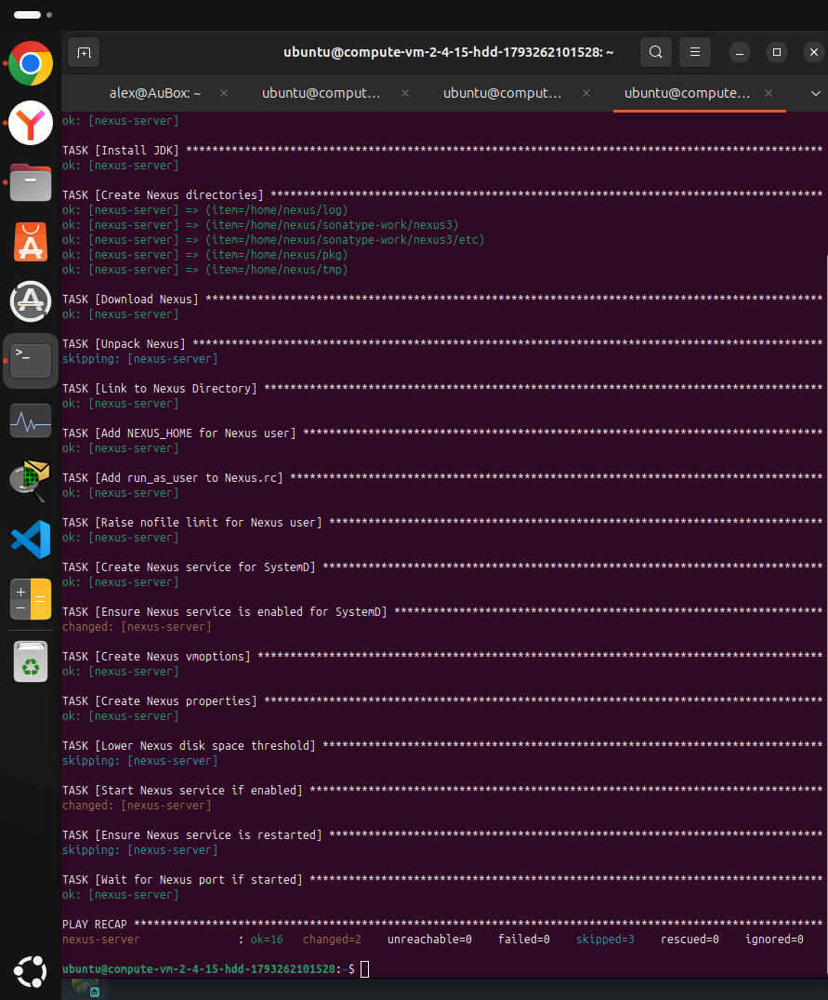
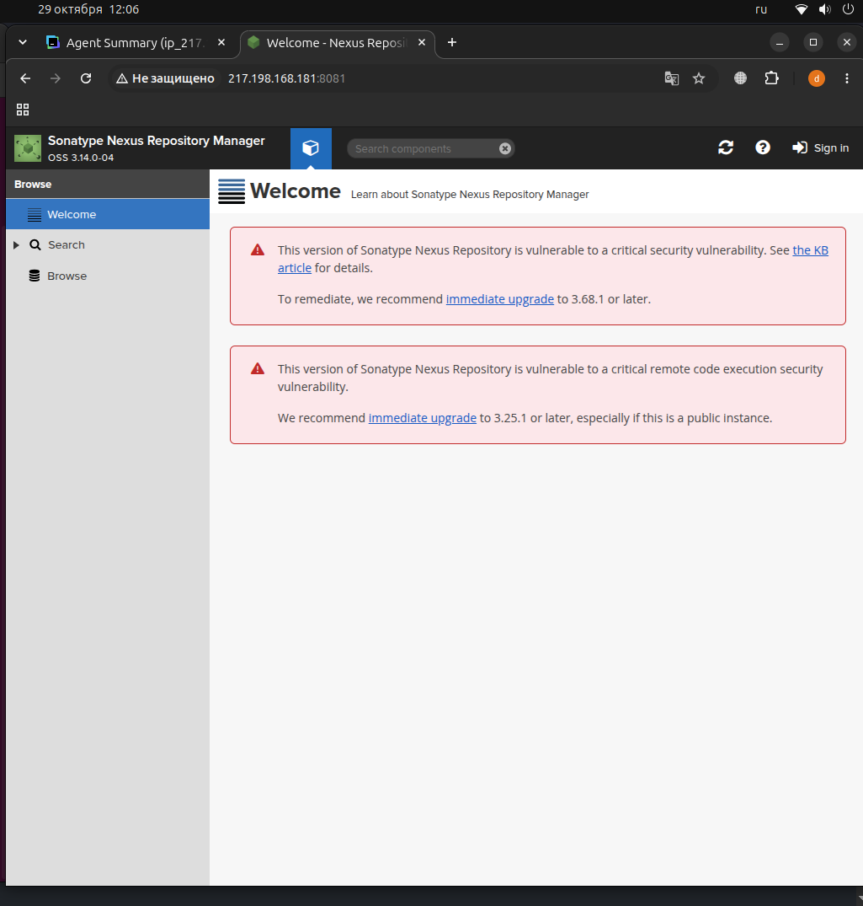
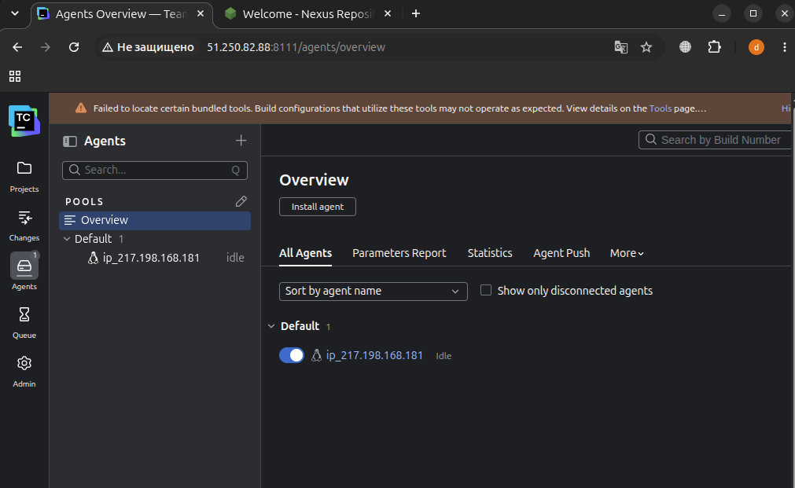
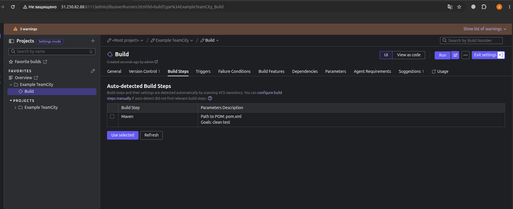
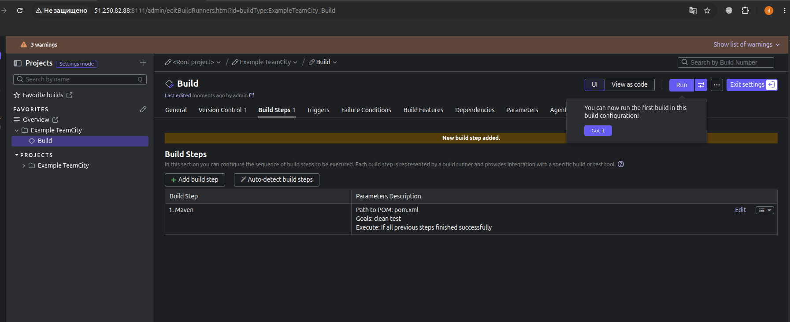
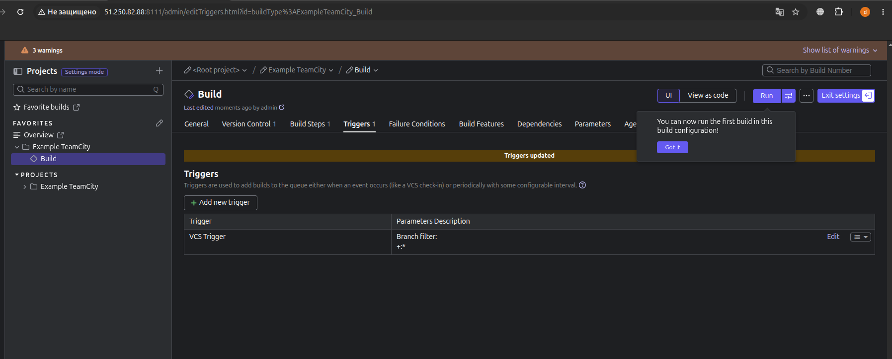
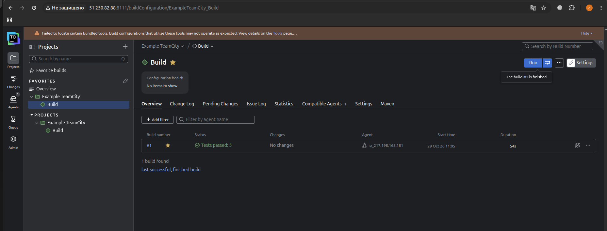
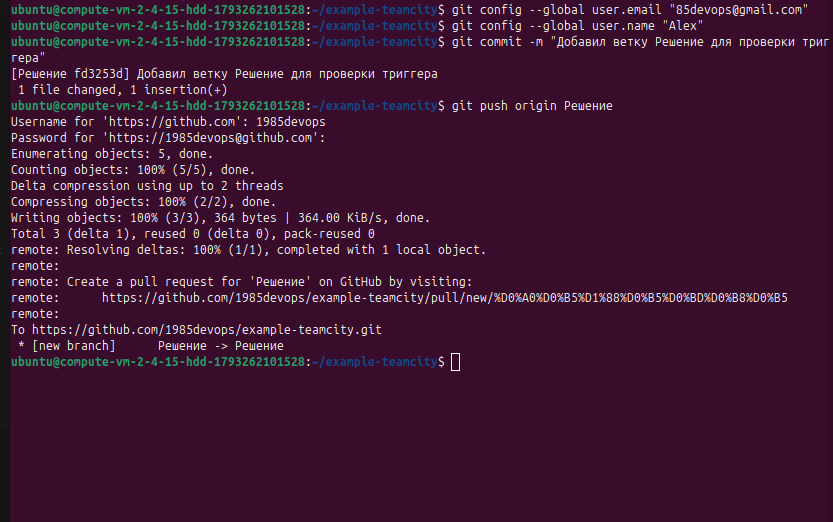
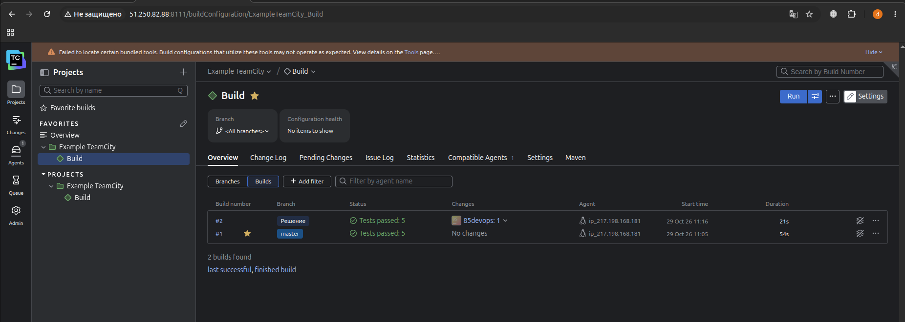
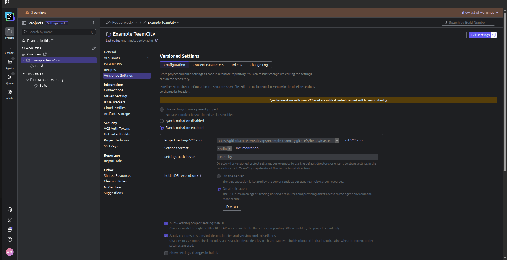
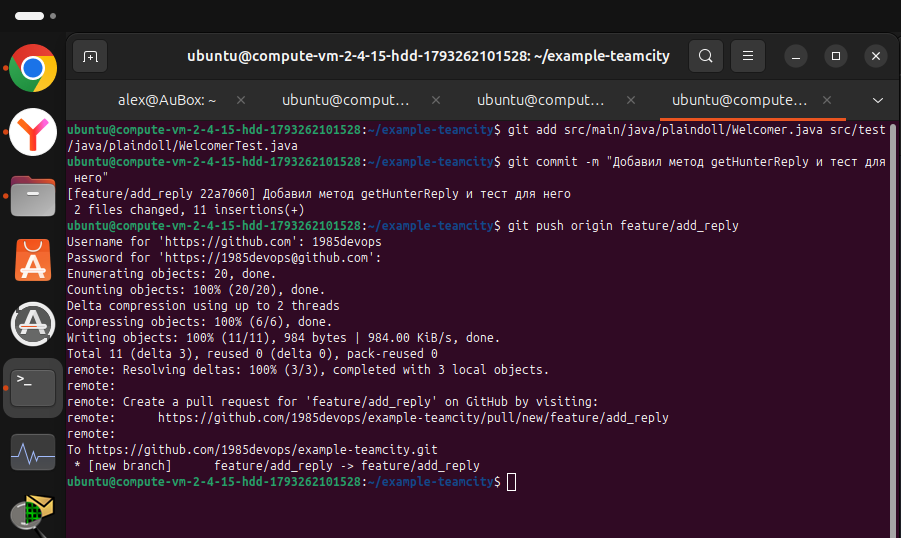
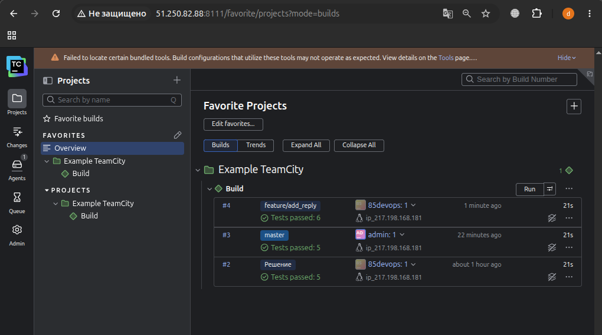
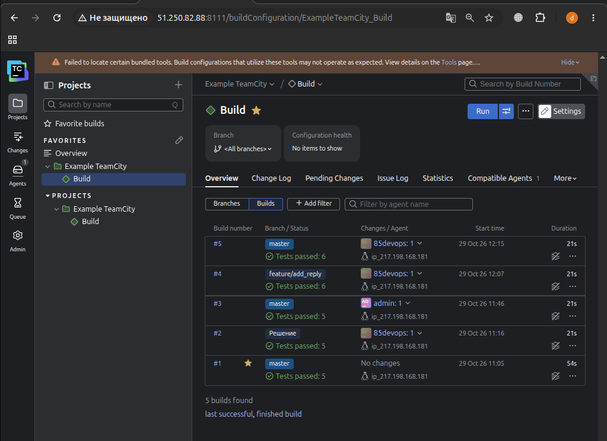
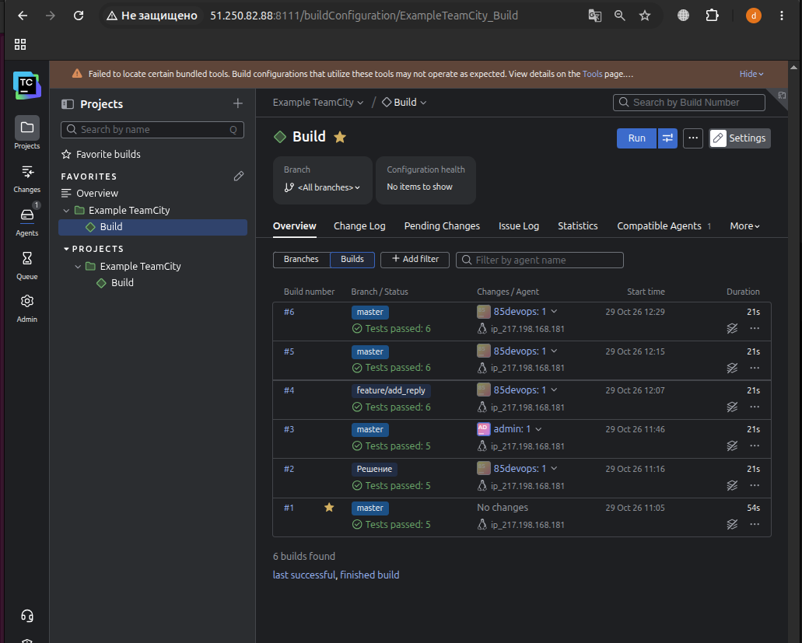
